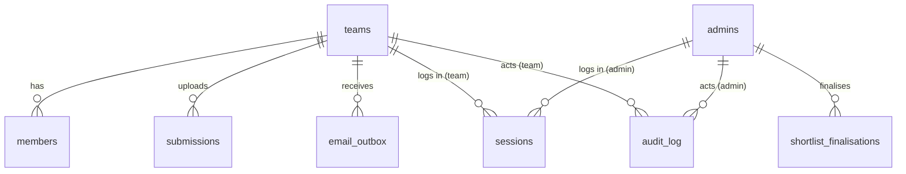

# SLIoT Challenge 2027: Full Site Architecture

Status: plan, agreed before the build. Last updated 2026-11-23.

## 1. What the site is

The official website of the SLIoT Challenge 2027, Sri Lanka's national IoT competition, run by the Department of Computer Science & Engineering, University of Moratuwa. It does two jobs:

1. **Tell people about the competition** on a single scrolling page: what it is, who can enter, the dates, prizes, sponsors, past editions, FAQs and how to get in touch.
2. **Run the competition's paperwork**: teams register and receive a team code by email, upload a project proposal (PDF), and, if shortlisted, submit a prototype video (YouTube link). Organizers follow everything from an admin dashboard and export it to Google Sheets or CSV.

Expected scale: about 200 teams, 10 organizer accounts, all participants 18 or older.

## 2. Pages and routes

All public content lives on **one page** (`/`). Only the logged-in apps and the registration form have their own URLs.

| Route | What it is | Who uses it |
|---|---|---|
| `/` | The one-page site (sections below) | Everyone |
| `/register` | Team registration form | New teams |
| `/team` | Team portal: log in with the team code, upload proposal, submit prototype | Registered teams |
| `/admin` | Admin dashboard | Organizers |
| `/api/...` | Route handlers for uploads, exports and health check | The site itself |

The old pages `/guidelines`, `/faqs`, `/finalists`, `/innovation-tour` and `/session_1` are **removed** (no redirects). Anything worth keeping from them moves into a section of the one-page site.

### Sections of the one-page site

In scroll order. The header links jump to each section (`/#about`, `/#faq` ...), and the active link highlights while scrolling.

| Section | Content | Status |
|---|---|---|
| Hero | Title, edition, one-line pitch, **Register** button, countdown to the next deadline | Requested |
| About | What SLIoT is, who runs it, the three-year story | Requested |
| Categories | School, University, Open: who can enter each | Proposed |
| How to take part | Register → proposal → shortlist → prototype → finals, with the proposal template download | Proposed |
| Timeline | Key dates. Registration, proposal and prototype dates are read from the admin settings on each visit (as are the callout, How to take part and the FAQ), so the page and the deadline locks never disagree | Requested |
| Prizes | Prize pool per category | Proposed (component exists) |
| Sponsors | Organizers, sponsors and partners with logos | Requested |
| Memories | Photo/video gallery of past editions, plus past winners | Requested |
| FAQ | Accordion of common questions | Requested |
| Contact us | Organizer contacts, email, social links | Requested |

Text content (sections, FAQs, sponsors, gallery list) lives in typed data files under `src/content/` (`faq.ts`, `sponsors.ts` ...), so editing a question or adding a sponsor is a one-file change. Gallery images stay in `public/images/` and are served resized by `next/image`.

### Coming-soon mode

The `COMING_SOON` flag stays, in `src/config/site.ts` (renamed from `site.mjs` in the TypeScript migration). While it is on, `/`, `/register` and `/team` show or redirect to the teaser. **`/admin` always works**, so organizers can create accounts and set deadlines before launch.

## 3. Technology stack

### Foundation changes (done first, before any feature work)

| Change | What it involves | Why |
|---|---|---|
| **TypeScript for the whole project** | Every `.js`/`.jsx`/`.mjs` file in `src/` (52 today) becomes `.ts`/`.tsx`; `next.config.mjs` becomes `next.config.ts`; `tsconfig.json` with `strict: true` and the `@/` path alias; `allowJs` only during the migration, then removed. `pnpm typecheck` (`tsc --noEmit`) runs locally and `next build` fails on type errors | Typed database rows, API inputs and email props catch mistakes before they reach production |
| **TypeScript version: 6.0.x, not 7.0** | Pin `typescript@~6.0.3` | TypeScript 7.0 is out, but `typescript-eslint` (used by Next.js's lint rules) supports only versions below 6.1 so far. Move to 7 once the lint tooling supports it |
| **Tailwind CSS 4** (4.3.x) | Run the official upgrade tool, then check by hand: the 369-line `tailwind.config.js` moves into CSS (`@theme` in `globals.css`), including the `cs-*` coming-soon colours and the `short` / `shorter` / `land` height breakpoints (as `@custom-variant`); `@tailwindcss/postcss` replaces the PostCSS plugin and `autoprefixer`; `tailwindcss-animate` is replaced by `tw-animate-css`; shadcn/ui set up for Tailwind 4; `prizes.scss` converted to plain CSS so `sass` can be removed | Current version, faster builds, CSS-first theme tokens shared by the site and the emails |

Tailwind 4 trade-off: it needs Safari 16.4+ (iPhones updated since 2023), Chrome 111+ and Firefox 128+. Older iPhones would see broken styling; Android phones on auto-updating Chrome are fine. After the upgrade the coming-soon page is re-checked at all 11 viewports used before.

### Already in the project

| Technology | Used for |
|---|---|
| Next.js 16 (App Router, Turbopack) | Pages, server rendering, route handlers, server actions |
| React 19 | UI |
| Tailwind CSS (upgraded to 4) + `tw-animate-css` | Styling |
| GSAP + ScrollTrigger (`@gsap/react`), Lenis (renamed from `@studio-freight/lenis` to `lenis`), Motion (renamed from `framer-motion` to `motion`) | Scroll scenes, smooth scrolling, component animation. See [frontend-plan.md](frontend-plan.md) section 4 |
| ~~three.js, `@react-three/fiber`, `drei`, `three-globe`~~ | Removed: the About globe is replaced by an animated SVG map of Sri Lanka (lighter on phones) |
| lucide-react, react-icons | Icons |
| pnpm 11 | Package manager (only one) |
| PM2 + nginx on the department VPS | Process manager and reverse proxy with HTTPS |
| GitHub Actions (self-hosted runner) | Deploy on every push to `main` |

### New for the full site

| Library / service | Used for | Why this one |
|---|---|---|
| **SQLite** (`better-sqlite3`) | The database | One file, no database server, fast, more than enough for 200 teams |
| **Drizzle ORM** + `drizzle-kit` | Schema, queries, migrations | Light, close to SQL, versioned migrations |
| **zod** | Validating every form and API input on the server | One schema shared by the form and the server |
| **react-hook-form** | Registration and upload forms | Good on phones, works with zod |
| **shadcn/ui** (Radix based, `components.json` exists) | Form controls, dialogs, tables in team portal and admin | Accessible, styled with our Tailwind tokens |
| **@tanstack/react-table** | The admin table: sort, filter, search, column picker | Handles a wide table of 200 rows easily |
| **React Email** (`@react-email/components`, `@react-email/render`, `react-email` dev preview) | Designing the emails as React components styled with Tailwind | Good-looking emails that render correctly in Gmail and Outlook, typed props, live preview while designing |
| **nodemailer** | Sending the rendered emails through Google Workspace SMTP | Standard, transport can be swapped later |
| **@googleapis/drive**, **@googleapis/sheets**, `google-auth-library` | Uploading proposals to Drive, writing the Sheets export | Per-API packages, much smaller than the full `googleapis` |
| **@node-rs/argon2** | Hashing admin passwords | Current best practice, prebuilt binaries (no build step) |
| **Cloudflare Turnstile** | Bot check on the registration form | Free, privacy friendly, works without moving DNS to Cloudflare |
| **Litestream** | Continuous database backup to R2 | Near-zero data loss, one-command restore |
| **sqlite3 CLI + age + rclone** | Nightly encrypted database snapshots to R2 | Independent second copy, readable files |
| **Cloudflare R2** | Off-server backup storage | Free tier covers us, no download fees |
| **Vitest**, **Playwright** | Unit tests and end-to-end tests of the registration and upload flows | Playwright is already used for visual checks |

`better-sqlite3` (13.x) ships prebuilt binaries for every platform inside the package, so its `node-gyp` build is declined in `pnpm-workspace.yaml` (`allowBuilds: better-sqlite3: false`). Allowing it makes pnpm compile from source, which needs Visual Studio on Windows.

## 4. Overall architecture

```
 Browser ──HTTPS──► nginx (TLS, upload size limit, rate limit, security headers)
                      │
                      ▼
            Next.js server (PM2, one process, 127.0.0.1:3000)
            ├─ one-page site, /register, /team, /admin
            ├─ server actions + route handlers
            ├─ background worker (started in instrumentation.ts):
            │     sends queued emails, retries failures
            │
            ├──► SQLite file  /var/lib/sliot/sliot.db   (WAL mode)
            │        ▲
            │        └── Litestream (systemd) ──► R2: continuous copy
            │        └── nightly and pre-deploy snapshots ──► R2: encrypted
            │
            ├──► Google Workspace SMTP  (sliot@cse.mrt.ac.lk)
            ├──► Google Drive API       (Shared Drive: proposals)
            ├──► Google Sheets API      (master export sheet)
            ├──► Cloudflare Turnstile   (verify registration token)
            └──► YouTube oEmbed         (check a prototype video exists)
```

Principles:

- **One process, one database file.** PM2 stays in `fork` mode with a single instance; SQLite in WAL mode handles our load without a separate database server.
- **The database lives outside the repository**, at `/var/lib/sliot/sliot.db`. The deploy runs `git reset --hard`, so nothing that must survive a deploy can sit in the repo folder.
- **All checks run on the server.** The browser forms validate for convenience only; deadlines, file types, sessions and roles are enforced in server code.
- **Slow outside services never break a user action.** Emails go through an outbox table and are sent in the background. Registration succeeds even if Gmail is briefly down.

## 5. Data model

Conventions:
- **Times** are stored in UTC as Unix milliseconds (`INTEGER`) and shown in Sri Lanka time (Asia/Colombo, UTC+5:30).
- **Booleans** are `INTEGER` 0/1. **Enums** are `TEXT`, checked by Drizzle and zod.
- **Key column:** PK = primary key, FK = foreign key, UQ = unique.
- **The team leader is member 1** (`members.position = 1`). All team emails go to the leader's email.

### Tables at a glance

| Table | One row is | Rows (about) | Written by |
|---|---|---|---|
| `teams` | A registered team | 200 | Registration, admins, shortlist finalise |
| `members` | One member of a team (member 1 is the leader) | 200–1,000 (1–5 per team) | Registration, admins |
| `submissions` | One proposal upload or prototype link (old versions kept) | 200–600 | Team portal |
| `admins` | One organizer account | 10 | Super admins, `pnpm admin:create` |
| `sessions` | One logged-in browser (team or admin) | Hundreds; expired rows cleaned daily | Logins |
| `settings` | One setting (deadline, shortlist state ...) | About 5 | Super admins, system |
| `shortlist_finalisations` | One press of **Finalise shortlist** | A handful | Shortlist page |
| `email_outbox` | One email to send or already sent | About 1,000 | Every flow that emails |
| `audit_log` | One recorded action | Thousands | Every important action |

### How the tables connect



`sessions` and `audit_log` point at a team or an admin through a type + id pair, so those two links are checked by the app rather than by database foreign keys.

### `teams`

| Column | Type | Key | Required | Notes |
|---|---|---|---|---|
| id | INTEGER | PK | ✓ | Auto-increment |
| code | TEXT | UQ | ✓ | Team code, e.g. `SL27-7KQ4-M9XD` |
| name | TEXT | | ✓ | Team name |
| category | TEXT | | ✓ | `school` \| `university` \| `open` |
| institution_name | TEXT | | school / university | The one school or university every member belongs to. Empty for Open teams, where each member has their own |
| institution_is_other | INTEGER | | ✓ | 0/1. 1 when a university was typed in with "Other" instead of picked from the list, so admins can spot typos |
| stage | TEXT | | ✓ | See the stage flow below. Default `registered` |
| shortlist_mark | INTEGER | | ✓ | Draft tick by a super admin, 0/1, default 0. Hidden from teams and admins until finalised |
| shortlist_emailed_at | INTEGER | | | When the "you're shortlisted" email was queued. Stops a re-finalise from emailing a team twice |
| finalist_emailed_at | INTEGER | | | When the "you're a finalist" email was queued. Stops a second announce from emailing a team twice |
| created_at | INTEGER | | ✓ | |
| updated_at | INTEGER | | ✓ | |

Stage flow:

| Stage | Set when |
|---|---|
| `registered` | The team registers |
| `proposal_submitted` | The first proposal is uploaded |
| `shortlisted` | The shortlist is finalised and the team is ticked |
| `not_shortlisted` | The shortlist is finalised and the team isn't ticked |
| `prototype_submitted` | A shortlisted team submits its first prototype link |
| `finalist` | A super admin announces the team as a finalist (only teams with a prototype). Un-marking returns it to `prototype_submitted` |

Indexes: `code` (unique), `category`, `stage`.

### `members`

| Column | Type | Key | Required | Notes |
|---|---|---|---|---|
| id | INTEGER | PK | ✓ | |
| team_id | INTEGER | FK → teams.id | ✓ | Deleted with the team |
| position | INTEGER | | ✓ | 1–5. **1 = team leader** |
| full_name | TEXT | | ✓ | |
| whatsapp | TEXT | | ✓ | WhatsApp number. Accepts `07X XXX XXXX` or `+94 7X XXX XXXX`, stored as `+947XXXXXXXX` |
| email | TEXT | UQ | ✓ | Stored lower-case. Unique across **all** teams: one team per person |
| institution_type | TEXT | | ✓ | `school` \| `university` \| `independent`. School and University teams: copied from the category. Open teams: chosen per member |
| institution_name | TEXT | | students | School or university name; `NULL` for independent members. School and University teams: copied from the team |
| institution_is_other | INTEGER | | ✓ | 0/1. 1 when the university was typed in with "Other" |
| nic | TEXT | UQ | non-school | Required when `institution_type` is `university` or `independent`, never asked of school students. Old format `123456789V` or new 12-digit format, stored upper-case. Unique across all teams |

Indexes: `team_id`; unique `email`; unique `nic` (empty values allowed, since SQLite treats them as distinct); unique (`team_id`, `position`).

Team rules, checked on the server at registration and when an admin edits a team:

| Rule | School team | University team | Open team |
|---|---|---|---|
| Members (including the leader) | 1–5 | 1–5 | 1–5 |
| Institution | One school for the whole team | One university for the whole team | Each member picks school student (names school), university student (names university), or independent (no institution); mixing is allowed |
| NIC | Not asked | Every member | Every university student and independent entrant |
| Email and NIC | Unique across all teams | Unique across all teams | Unique across all teams |

### `submissions`

Every upload is kept. The newest per team and kind is the current one.

| Column | Type | Key | Required | Notes |
|---|---|---|---|---|
| id | INTEGER | PK | ✓ | |
| team_id | INTEGER | FK → teams.id | ✓ | |
| kind | TEXT | | ✓ | `proposal` \| `prototype` |
| version | INTEGER | | ✓ | 1, 2, 3 ... per team and kind |
| is_current | INTEGER | | ✓ | 1 for the latest of each kind, 0 for older versions |
| drive_file_id | TEXT | | proposals | Google Drive file ID |
| drive_url | TEXT | | proposals | Link for organizers |
| file_name | TEXT | | proposals | Name in Drive, e.g. `SL27-7KQ4-M9XD – Team – v2.pdf` |
| size_bytes | INTEGER | | proposals | At most 10 MB |
| sha256 | TEXT | | proposals | Fingerprint of the file |
| youtube_id | TEXT | | prototypes | 11-character video ID |
| youtube_url | TEXT | | prototypes | Normalised `https://www.youtube.com/watch?v=...` |
| submitted_at | INTEGER | | ✓ | |
| submitted_ip | TEXT | | ✓ | |

Indexes: (`team_id`, `kind`, `is_current`); unique (`team_id`, `kind`, `version`).

### `admins`

| Column | Type | Key | Required | Notes |
|---|---|---|---|---|
| id | INTEGER | PK | ✓ | |
| username | TEXT | UQ | ✓ | Lower-case |
| display_name | TEXT | | ✓ | Shown in the audit log |
| password_hash | TEXT | | ✓ | argon2id |
| role | TEXT | | ✓ | `super_admin` \| `admin` |
| disabled | INTEGER | | ✓ | 0/1. Disabled accounts can't log in and their sessions are deleted |
| last_login_at | INTEGER | | | |
| created_at | INTEGER | | ✓ | |

### `sessions`

| Column | Type | Key | Required | Notes |
|---|---|---|---|---|
| id | TEXT | PK | ✓ | SHA-256 of the random 32-byte token. The raw token exists only in the cookie |
| subject_type | TEXT | | ✓ | `team` \| `admin` |
| subject_id | INTEGER | | ✓ | teams.id or admins.id |
| created_at | INTEGER | | ✓ | |
| expires_at | INTEGER | | ✓ | Teams: 7 days. Admins: 12 hours |
| ip | TEXT | | | |
| user_agent | TEXT | | | |

Indexes: (`subject_type`, `subject_id`), `expires_at`.

### `settings`

| Column | Type | Key | Required | Notes |
|---|---|---|---|---|
| key | TEXT | PK | ✓ | |
| value | TEXT | | ✓ | JSON-encoded |
| updated_by | INTEGER | | | admins.id |
| updated_at | INTEGER | | ✓ | |

The keys:

| Key | Value | Changed by |
|---|---|---|
| `registration_closes_at` | Time | Super admins (settings page) |
| `proposal_due_at` | Time | Super admins |
| `prototype_due_at` | Time | Super admins |
| `shortlist_state` | `draft` \| `finalised` | Shortlist page (Finalise / Reopen) |
| `last_sheet_export_at` | Time | Sheets export |

### `shortlist_finalisations`

One row per press of **Finalise shortlist**, so every version of the shortlist is on record.

| Column | Type | Key | Required | Notes |
|---|---|---|---|---|
| id | INTEGER | PK | ✓ | |
| finalised_by | INTEGER | FK → admins.id | ✓ | |
| finalised_at | INTEGER | | ✓ | |
| shortlisted_count | INTEGER | | ✓ | Teams shortlisted in this version |
| newly_emailed_count | INTEGER | | ✓ | Emails queued by this finalise |
| team_ids | TEXT | | ✓ | JSON list of the shortlisted team IDs: a snapshot of this version |

### `email_outbox`

| Column | Type | Key | Required | Notes |
|---|---|---|---|---|
| id | INTEGER | PK | ✓ | |
| team_id | INTEGER | FK → teams.id | | The team the email is about, if any |
| to_email | TEXT | | ✓ | |
| template | TEXT | | ✓ | `registration_confirmed` \| `code_reminder` \| `proposal_received` \| `shortlisted` \| `prototype_received` \| `prototype_reminder` \| `semifinalist` \| `finalist` |
| props | TEXT | | ✓ | JSON props for the React Email template, rendered at send time |
| status | TEXT | | ✓ | `pending` \| `sent` \| `failed` |
| attempts | INTEGER | | ✓ | Default 0. Gives up after 6 |
| next_attempt_at | INTEGER | | ✓ | When the worker should try next |
| last_error | TEXT | | | Last SMTP error, shown in the dashboard |
| created_at | INTEGER | | ✓ | |
| sent_at | INTEGER | | | |

Index: (`status`, `next_attempt_at`).

### `audit_log`

Records registrations, logins (including failed ones), uploads, edits, shortlist changes, finalise and reopen, exports, settings and admin account changes. Rows are only added, never edited.

| Column | Type | Key | Required | Notes |
|---|---|---|---|---|
| id | INTEGER | PK | ✓ | |
| actor_type | TEXT | | ✓ | `team` \| `admin` \| `system` \| `anonymous` |
| actor_id | INTEGER | | | teams.id or admins.id |
| action | TEXT | | ✓ | e.g. `team.registered`, `proposal.uploaded`, `shortlist.finalised`, `admin.login_failed` |
| target_type | TEXT | | | e.g. `team`, `admin`, `setting` |
| target_id | TEXT | | | |
| details | TEXT | | | JSON: what changed (old → new) |
| ip | TEXT | | | |
| created_at | INTEGER | | ✓ | |

Indexes: `created_at`, (`target_type`, `target_id`).

## 6. Feature flows

### 6.1 Registration (`/register`)

1. The team fills in the form, in this order:

   | Part | Fields | Notes |
   |---|---|---|
   | Team | Team name, category (School / University / Open) | The category decides what the rest of the form asks |
   | Institution (School and University teams only) | **School:** school name, typed in. **University:** dropdown of the main universities plus **Other**; choosing Other shows a text field for the name | Asked once and applied to every member, so all members are from the same place by design |
   | Members | Member 1 is labelled **Team leader**. "Add member" adds up to 5 in total; any member except the leader can be removed. Each member: full name, WhatsApp number, email, and NIC if they're a university student | **Open teams only:** each member also picks School or University and names their institution, with the same dropdown + Other for universities |

   A hidden honeypot field and a Turnstile widget sit on the form.

   The university list lives in `src/content/universities.ts` so it can be edited without touching the form. Proposed list: the state universities (Colombo, Peradeniya, Sri Jayewardenepura, Kelaniya, Moratuwa, Jaffna, Ruhuna, Open University of Sri Lanka, Eastern, South Eastern, Rajarata, Sabaragamuwa, Wayamba, Uva Wellassa, Visual and Performing Arts, Vavuniya, Gampaha Wickramarachchi University of Indigenous Medicine), General Sir John Kotelawala Defence University, and the larger private ones (SLIIT, NSBM, IIT, SLTC, APIIT, CINEC, Horizon Campus, ICBT), then **Other**.

2. The server checks that:
   - registration is open, the Turnstile token is valid, the honeypot is empty and the IP is under the rate limit
   - the input passes zod: 1–5 members, WhatsApp numbers are Sri Lankan mobiles, NICs are in a valid format, NIC is present for every university student
   - no email or NIC appears twice in the form, or in any existing team. If one does, the form says which member to fix
   - school and university teams carry the team's institution on every member
   - the team name is one line with no link or web address, since it goes into emails and anyone can enter any leader address (added 2026-11-27)
3. The server generates the team code: `SL27-` + 8 random characters from the Crockford base-32 alphabet (no I, L, O, U, so it's easy to read aloud), e.g. `SL27-7KQ4-M9XD`. That's about a trillion possibilities. Generated with `crypto.randomInt`, retried on the rare collision.
4. The team and members are saved in one transaction (the unique indexes on email and NIC catch two teams registering the same person at the same moment). A "registration confirmed" email with the code is queued for the leader, and the action is written to the audit log.
5. The confirmation screen shows the team code too, with a copy button, in case the email is slow.

### 6.2 Team login (`/team`)

- **Locked until proposal submissions open** (added 2026-11-27): before `proposalOpens` (`src/content/deadlines.ts`, 21 December) the server refuses login, uploads and prototype links, `/team` shows only the opening date, and the navigation hides "Team login". Registration itself is not affected.
- Teams log in with the **team code only** (decision D2-A).
- Because the code is the only secret, these protections come with it:
  - **Long random code:** about a trillion possibilities.
  - **Rate limit:** 5 attempts per 15 minutes per IP in the app, plus nginx `limit_req` on the login endpoint.
  - **Email on every upload:** the leader hears about each proposal or prototype submission, so misuse is noticed quickly.
  - **Audit log:** every login and upload is logged with its IP.
- **"Forgot your code?":** the team enters the leader email. If it matches a team, the code is emailed to that address only. The screen gives the same reply whether or not the email exists. Besides the 5 requests per 15 minutes per IP, each team gets at most one reminder email every 5 minutes (added 2026-11-27); an organizer's "resend code" isn't limited by this.
- **Session:** a random token in an `httpOnly`, `Secure`, `SameSite=Lax` cookie, valid 7 days and stored hashed in `sessions`. Logging out deletes it.

### 6.3 Proposal upload

1. The team portal shows the current proposal (if any), its history and the deadline.
2. The upload goes to the route handler `POST /api/team/proposal` (not a server action, whose 1 MB body limit is too small).
3. The server checks the session, that the proposal deadline hasn't passed, the size (at most 10 MB) and that the file starts with `%PDF-`. It also computes a SHA-256 of the file.
4. The file is uploaded to Drive as `sliot@cse.mrt.ac.lk` through OAuth (decision D4, changed) into `SLIoT 2027 Proposals/<Category>/` (category folders are created on first use), named `SL27-7KQ4-M9XD – <Team name> – v<n>.pdf`. Files stay private: the folder is shared only with organizers and judges, with no "anyone with the link" sharing. Until the Drive settings exist the upload is refused with "not set up yet" and nothing is saved.
5. The Drive file ID and link are saved as a new `submissions` row. It becomes current and the previous one stays in the history. The team stage moves to `proposal_submitted`.
6. A "proposal received" email is queued for the leader.

Teams can replace the proposal any number of times until the deadline. The newest upload is the one judged.

### 6.4 Prototype submission (shortlisted teams only)

1. The prototype form appears only when the shortlist has been finalised, the team's stage is `shortlisted`, and the prototype deadline hasn't passed.
2. The team pastes a YouTube link. The server accepts `youtube.com/watch?v=`, `youtu.be/`, `/shorts/` and `/embed/` forms, extracts the 11-character video ID and checks it with YouTube oEmbed. Private videos fail, so teams must use public or unlisted.
3. The link is saved as a `submissions` row (replaceable until the deadline), the stage moves to `prototype_submitted`, and a "prototype received" email is queued.

### 6.5 Admin dashboard (`/admin`)

**Login:** username + password, no authenticator app (decision D3-B).
- **New accounts:** a super admin creates the account and the system generates a strong random password (16 characters). It's shown once to the super admin, who passes it to the new admin privately. The admin keeps using that password; there is no "change password" screen.
- **Forgotten password:** a super admin generates a new one the same way. The old password stops working and that admin's sessions end.
- **Storage:** passwords are hashed with argon2; failed logins are rate limited and logged. There is no email reset flow.
- **First account:** the first super admin is created with a command on the server (`pnpm admin:create`), which prints the generated password.

| Feature | Admin | Super admin |
|---|---|---|
| Big team table: all teams with code, name, category, institution, leader, member count, stage, proposal link, video link, dates; expand a row to see every member. Sort, filter by category/stage/institution, search (team, member name, email, NIC), choose columns | ✓ | ✓ |
| Team detail: full info, submission history, audit trail | ✓ | ✓ |
| Edit team details (fix typos) | ✓ | ✓ |
| See each team's shortlist result (after the shortlist is finalised) | ✓ | ✓ |
| Shortlisting page: mark teams, finalise, reopen (see 6.6) | | ✓ |
| Resend a team's code email | ✓ | ✓ |
| Download CSV | ✓ | ✓ |
| Export to Google Sheets | ✓ | ✓ |
| Settings: registration, proposal and prototype deadlines | | ✓ |
| Manage admin accounts: create, disable, reset password, change role | | ✓ |
| View audit log | | ✓ |

### 6.6 Shortlisting (super admins only)

A dedicated page, `/admin/shortlist`, visible only to super admins.

1. **Mark (draft).**
   - The page lists every team that submitted a proposal, with the proposal link, category and a checkbox.
   - Super admins tick the teams to shortlist, one by one or in bulk, filtered by category.
   - Ticks save straight away as a draft (`shortlist_mark`). Several super admins can work on it over several days.
   - While the list is a draft, teams see nothing new in their portal, regular admins don't see the marks, and no email is sent.
2. **Review.** A summary shows the count per category and the full list of ticked teams.
3. **Finalise.** Pressing **Finalise shortlist** opens a confirmation dialog: "This will email N teams and open prototype submission for them." The super admin types `FINALISE` to confirm. Then, in one database transaction:
   - each team's stage becomes `shortlisted` or `not_shortlisted`, from its mark
   - `shortlist_state` becomes `finalised`
   - a "you're shortlisted" email is queued for every shortlisted team whose `shortlist_emailed_at` is empty, and the time is recorded
   - a `shortlist_finalisations` row and an audit log entry are written
4. **After finalising:**
   - Shortlisted teams see the result and the prototype form in their portal.
   - Teams that weren't shortlisted see "not shortlisted" in their portal. They get **no email** (decision).
   - The result column appears in the admin table and in the exports.
5. **Reopen (if the list needs changing).**
   - A super admin presses **Reopen shortlist** (with a confirmation). `shortlist_state` goes back to `draft`, but teams keep their published result until the next finalise.
   - The marks are changed, then the list is finalised again.
   - Only **newly shortlisted** teams get an email. Teams already emailed are never emailed twice.
   - Every finalise is recorded, so the history of changes is visible.

### 6.6a Finalists (super admins only)

Added during step O. A lighter process than the shortlist, because it is smaller, later and decided by a person checking the list.

1. A super admin ticks teams that have **submitted a prototype**. A team without one can't be a finalist.
2. **Announce finalists** asks for the word `FINALISTS`. The chosen teams' stage becomes `finalist`, and each newly announced team's leader gets a "you're a finalist" email once (`finalist_emailed_at` stops a repeat). The action is written to the audit log.
3. There is no draft step and no reopen. To correct a mistake a super admin un-marks a team: it returns to `prototype_submitted`, no email is sent, and the audit log records it.
4. A finalist sees "Finals" lit in the team portal's status tracker, with the finale date. A finalist can no longer replace the prototype link.
5. If the shortlist is re-finalised, a finalist who is still ticked stays a finalist; one who is unticked becomes `not_shortlisted`.

### 6.6b Removing test teams

Added 2026-11-27, for test registrations on the live site. The dashboard has no delete. On the server, `pnpm team:delete <code> ...` lists what would go; with `--yes` it saves a copy of the database beside the original, then deletes the teams with their members, submissions, emails and sessions in one transaction, and adds `team.deleted` to the audit log. A team that is in a finalised shortlist is refused. Proposal files in Drive are removed by hand (the script prints the links), and the Sheet is exported again.

### 6.7 Exports

- **Layout of both exports:** one row per team. Team columns first (code, name, category, institution, stage, proposal and video links, dates), then member columns `M1 name`, `M1 WhatsApp`, `M1 email`, `M1 institution`, `M1 NIC` ... up to `M5`. M1 is the leader. Empty columns for smaller teams.
- **CSV download:** generated on request from the current table filter, UTF-8 with a byte-order mark so Excel shows Sinhala and Tamil names correctly.
- **Google Sheets (decision D7-B):** one master spreadsheet. "Export to Sheets" clears the `Teams` tab and rewrites it from the database, then saves the export time.
  - **One way only:** the export goes from the database to the Sheet. Editing the Sheet never changes the database, and edits on the `Teams` tab are overwritten by the next export.
  - **Notes and judges' scores** go on other tabs that look up rows by team code; the export never touches them.
  - **Real changes** (shortlisting, corrections) are made in the admin dashboard, where they are checked and logged.

## 7. Email

**Decision D1-A:** send through Google Workspace SMTP from a dedicated account, `sliot@cse.mrt.ac.lk`.

- **Why it works:** `cse.mrt.ac.lk` already uses Google Workspace, with Google in its SPF record and Google DKIM signing. Mail from it lands in inboxes, and replies reach a real mailbox the team reads.
- **Connection:** `smtp.gmail.com`, port 587 (STARTTLS), authenticated with an **app password**. The account needs 2-Step Verification on, and the department admin must allow app passwords.
- **Limits:** Workspace allows about 2,000 messages a day per account. We expect roughly 200 teams × 4 emails over months, with peaks of a few hundred on deadline days.
- **Outbox and worker:**
  - Every email is first written to `email_outbox`.
  - A background worker, started once in `instrumentation.ts`, sends pending emails about one every two seconds.
  - Failures are retried with growing gaps (1 min, 5 min, 30 min, 2 h, 12 h), then marked `failed` and shown in the admin dashboard.
  - At peak the shortlist finalise queues one email per shortlisted team; at one every two seconds, 60 emails go out in about two minutes, well inside Gmail's limits.
- **Templates (React Email):**
  - Each email is a typed React component in `src/emails/`, built from React Email's components (`Html`, `Container`, `Button` ...) and styled with its `Tailwind` wrapper using the site's colours.
  - They share one layout: SLIoT logo (loaded from the site by absolute URL), a short heading, the message, one clear button, and a footer with contacts and social links.
  - The worker renders each email with `@react-email/render` to HTML **and** a plain-text version, so it reads well in every client and spam filters trust it.
  - Templates: registration confirmed (team code + category delegates WhatsApp group CTA), code reminder, proposal received, shortlisted (with prototype deadline and portal link), prototype received, prototype submission reminder (**TODO:** trigger not wired yet), semi-finalist selected (**TODO:** stage/trigger not wired yet), and finalist.
  - The outbox stores the template name and its props, not rendered HTML, so a fixed template applies to retries too.
- **Development:**
  - `pnpm email:dev` opens React Email's preview server to design the templates with sample data.
  - No console transport (decided 2026-11-24): until the SMTP settings exist, emails stay `pending` in the outbox with `last_error` "SMTP not configured", visible in the dashboard, and send once they're added. Production refuses to start without them.
  - Before launch, each template is sent once to real Gmail and Outlook inboxes and checked on phone and desktop.
- **Recommended to dept IT (not blocking):** add a DMARC record for `cse.mrt.ac.lk`. There is none today.
- **Changing provider later:** if the mailbox ever becomes a problem, only the nodemailer transport changes (e.g. to Resend or Amazon SES). Templates and outbox stay the same.

## 8. Security

| Risk | Control |
|---|---|
| Bots registering junk teams | Turnstile, honeypot field, rate limit per IP |
| Guessing team codes | About a trillion combinations; 5 attempts per 15 min per IP (app) + nginx `limit_req`; failed attempts logged |
| A leaked team code | Leader emailed on every upload; full history kept, so an organizer can restore the previous version; admin can issue a new code |
| Admin password attacks | System-generated 16-character random passwords, argon2 hashes, rate-limited login, per-person accounts that can be disabled, every action audit logged |
| Stolen session cookies | `httpOnly`, `Secure`, `SameSite=Lax`, hashed in the database, expire after 7 days (admins: 12 hours), deleted on logout |
| Cross-site request forgery | `SameSite` cookies, plus Next.js checks the `Origin` of server actions; route handlers check `Origin` too |
| Malicious or oversized uploads | 10 MB limit (nginx `client_max_body_size 12m` on the upload route and in the handler), `%PDF-` signature check, file never served from our server: it goes straight to Drive |
| Bad input / injection | zod validation on every input; Drizzle parameterized queries; React escapes output |
| Missed deadlines bypassed | Deadlines checked on the server against the settings table, not in the browser |
| Script injection | Content-Security-Policy and security headers (HSTS, `X-Content-Type-Options`, `Referrer-Policy`, `frame-ancestors 'none'`), allowing only our own origin plus Turnstile |
| Leaked secrets | Secrets only on the server, never in Git (see below); Google key file readable only by the app user; R2 keys only in the backup tools' config, not in the app |
| Vulnerable dependencies | Dependabot alerts on the repo, `pnpm audit` before each release |
| Personal data | Collect only what the competition needs (NIC only from university students); no privacy page or consent checkbox on registration (decision: removed during step N; note the Sri Lanka Personal Data Protection Act, No. 9 of 2022); proposals private in Drive; the export Sheet shared only with organizers, since it holds NICs and phone numbers; admin access logged |

### Secrets and configuration

Stored on the server in `/etc/sliot/sliot.env` (owner: app user, mode 600), linked into the app folder as `.env.production.local` (git-ignored, survives deploys). A copy lives in the organizers' password manager for disaster recovery. Names only:

`DATABASE_PATH`, `SITE_URL`, `SMTP_HOST`, `SMTP_PORT`, `SMTP_USER`, `SMTP_PASSWORD` (the app password), `EMAIL_FROM`, `GOOGLE_OAUTH_CLIENT_ID`, `GOOGLE_OAUTH_CLIENT_SECRET`, `GOOGLE_OAUTH_REFRESH_TOKEN`, `GOOGLE_DRIVE_FOLDER_ID`, `GOOGLE_SERVICE_ACCOUNT_KEY_FILE` (`/etc/sliot/google-sa.json`), `GOOGLE_SHEET_ID`, `TURNSTILE_SECRET_KEY`, `NEXT_PUBLIC_TURNSTILE_SITE_KEY`. The list with notes is `.env.example`; `src/server/env.ts` checks them, and production refuses to start while a required one is missing (the Sheets pair is optional).

R2 credentials live only in `/etc/litestream.yml` and `/etc/sliot-backup/rclone.conf`, both owned by root with mode 600, so the app user can't read them.

## 9. Backup and recovery

**Decision D6-C:** Litestream for continuous backup, plus a nightly encrypted snapshot. Both go to one Cloudflare R2 bucket, `sliot-backups`.

### What gets backed up

| Data | Where it lives | How it's protected |
|---|---|---|
| Database (teams, submissions, admins, settings, logs) | `/var/lib/sliot/sliot.db` | Litestream + nightly snapshot to R2 |
| Proposal PDFs | Google Drive (a folder in the `sliot@` My Drive, decision D4) | Google's storage; Drive keeps deleted files 30 days in trash |
| Prototype videos | YouTube (teams' own accounts) | Only the link is ours; it's in the database |
| Code | GitHub | Git |
| Secrets | `/etc/sliot/` | Copy in the organizers' password manager |

### How the backup runs

Both run as root (decided 2026-11-25). Scripts, configs and the server setup guide are in `deploy/backup/`.

1. **Litestream** runs as a systemd service next to the app. It watches the database's WAL and uploads new changes to `r2:sliot-backups/litestream/`, at most every 10 seconds, only when something changed. It keeps 7 days of point-in-time history.
2. **Nightly snapshot:** a systemd timer runs `sliot-snapshot nightly` at 02:30 Sri Lanka time:
   - takes a consistent copy with `sqlite3 sliot.db ".backup ..."`
   - runs `PRAGMA integrity_check` on the copy and checks the teams table is there
   - compresses it, then encrypts it with `age` using a public key (the private key is kept offline in the password manager, never on the server)
   - uploads it with rclone to `r2:sliot-backups/snapshots/nightly/<date and time>.db.gz.age`
3. **Retention:** an R2 lifecycle rule deletes snapshots after 90 days. A 30-day bucket lock on `snapshots/` (required, see D6) stops even a compromised server from deleting recent snapshots; the continuous Litestream copy is not protected this way. File names carry the time, so a rerun never overwrites a locked file.
4. **Monitoring:** after each successful nightly snapshot the script pings a free dead-man's-switch check (healthchecks.io, cron `30 2 * * *` Asia/Colombo with 2 hours' grace), and reports a failed run at once. Organizers get an email on a failure or a missing ping. Deploys never ping it.
5. **Before every deploy** the first workflow step runs `sliot-snapshot pre-migrate` (allowed by a one-line sudo rule), so a bad schema change can be undone. If the copy can't be made or fails its check, the deploy stops with the running site untouched. The last 10 copies stay in `/var/backups/sliot` (root only); if only the upload to `snapshots/pre-migrate/` fails, the deploy continues with a warning. With no database yet, the step is skipped.

### Cost

Free on R2's free tier: 10 GB storage, 1 million writes and 10 million reads a month, free downloads. Our database is a few MB. Litestream's worst case (a change every 10 seconds, all month) is about 260,000 writes, and snapshots add about 30. Cloudflare requires a card or PayPal on file to turn on R2 even when usage stays free, and has no hard spending cap, so we set a billing notification at $1.

### Recovery targets

- **Data loss (RPO):** about 10 seconds with Litestream; at most one day if only the snapshots survive.
- **Time to recover (RTO):** under one hour on a prepared server.

### Restore runbook (VPS lost)

Commands for every kind of restore are in `deploy/backup/README.md`.

1. Get a server with Node 22 or later, pnpm, PM2, nginx, Litestream, sqlite3, age and rclone.
2. Clone the repository to `/var/www/sliot/SLIoT-Challenge-2025`, `pnpm install`, `pnpm build`.
3. Restore secrets to `/etc/sliot/` from the password manager.
4. Set up the backup tools (`deploy/backup/README.md`), then `sliot-restore litestream <file>` (or, if that fails, `sliot-restore snapshot latest <file>` with the age private key). Both check the file's integrity.
5. Move the restored file into place, start Litestream and the app with PM2, apply the nginx config and TLS certificate.
6. If the server IP changed, ask university IT to point `sliot.cse.mrt.ac.lk` at the new IP.
7. Check: home page loads, an admin can log in, the team count matches.

**Restore drill:** before registration opens, then once a month during the competition, restore both backups to a laptop with a read-only R2 token, compare team counts with the live dashboard, and delete the restored files.

**Testing before launch:** the production server's backup tools, settings and sudo rule were set up on 2026-11-26, and the timer and Litestream start after the first deploy. Besides the server, `deploy/backup/test-local.sh` tests the scripts with a folder standing in for R2, and `deploy/backup/rehearse.sh` runs both backups and restores against the real bucket under `rehearsal/`, from a laptop with seeded data.

## 10. Deployment changes

The existing pipeline (push to `main` → self-hosted runner → install → build → PM2 reload → health check) stays, with these additions:

- **Database snapshot and migrations:** the first step takes a pre-migration snapshot; `pnpm db:migrate` runs after the build, before the restart.
- **Health check:** the check calls `/api/health`, which returns 503 when the database can't be read. It also reports the number of waiting and failed emails; those don't fail the deploy. The route is public and returns nothing else.
- **nginx:**
  - `client_max_body_size 12m` on `/api/team/proposal`
  - `limit_req` zones for the team and admin login endpoints (POSTs only) and registration
  - security headers are sent by Next.js itself (`next.config.ts`), so nginx doesn't add them
  - the old `/register` redirect must be removed at launch, since `/register` is now the app's page
  - all of it is in `deploy/nginx.conf.example`. The limits and the upload size were applied on the shared production server on 2026-11-26 as separate files included from its existing site config; `/register` follows at launch
- **One-time server setup** (`deploy/backup/README.md`): the `/var/lib/sliot`, `/etc/sliot` and `/etc/sliot-backup` folders, the Litestream service, the snapshot timer, the sudo rule and the rclone config.

## 11. Accounts and access needed before the build

| What | Who | Used for |
|---|---|---|
| `sliot@cse.mrt.ac.lk` mailbox with 2-Step Verification and an app password | Dept Workspace admin | Sending email |
| Google Cloud project (under a department account) with Drive API and Sheets API enabled, plus a service account with a JSON key | Organizers | Drive uploads, Sheets export |
| Folder "SLIoT 2027 Proposals" in the `sliot@` My Drive, an OAuth client and refresh token, judges as viewers (D4) | Organizers | Proposal storage |
| Master Google Sheet shared with the service account as editor | Organizers | Sheets export |
| Cloudflare account: R2 bucket `sliot-backups`, an API token limited to that bucket, a Turnstile widget for `sliot.cse.mrt.ac.lk` | Organizers | Backups, bot check |
| healthchecks.io check (free) | Organizers | Backup monitoring |

## 12. Build plan

1. **TypeScript migration (first action):**
   - Add `typescript@~6.0.3`, `tsconfig.json` (`strict: true`), `@types/*` packages and the `pnpm typecheck` script.
   - Convert every file to `.ts`/`.tsx`, including `next.config.ts`, `site.ts`, `eslint.config` and `src/constants`.
   - Turn on the TypeScript rules in ESLint.
   - Done when `allowJs` is removed and lint, typecheck and build pass with the site looking identical (screenshots before/after).
2. **Tailwind 4 upgrade:**
   - Run `npx @tailwindcss/upgrade`, then move the theme into `@theme` in `globals.css`, the height breakpoints into `@custom-variant`, and swap `tailwindcss-animate` for `tw-animate-css`.
   - Update shadcn/ui for Tailwind 4, convert `prizes.scss` to CSS and remove `sass`.
   - Done when the coming-soon page and the current full site match their before screenshots at all 11 viewports.
3. **Frontend (all screens on sample data):** the one-page site, `/register`, `/team` and `/admin`, built against a typed sample-data layer, as detailed in [frontend-plan.md](frontend-plan.md). Old pages and their routes are removed from `site.ts`. Steps 4–9 then replace the sample-data layer with the real backend.
4. **Data layer:** add Drizzle + better-sqlite3, write the schema and first migration, the database client (WAL mode, foreign keys on), the settings helpers and `pnpm admin:create`.
5. **Email:** outbox table, worker in `instrumentation.ts`, React Email templates and preview server, nodemailer transport (console transport in development).
6. **Registration:** `/register` form, Turnstile, team code generator, confirmation email and screen.
7. **Team portal:** code login, sessions, "forgot your code", proposal upload to Drive, prototype link, submission emails, deadline locks.
8. **Admin dashboard:** login and roles, team table, team detail, editing, CSV and Sheets export, settings, admin management, audit log.
9. **Shortlisting:** the super-admin `/admin/shortlist` page with draft marks, Finalise (emails to newly shortlisted teams), Reopen and finalisation history.
10. **Security hardening:** headers and CSP, rate limits, `Origin` checks, nginx changes.
11. **Backups and ops:** Litestream service, snapshot timer with age + rclone, R2 lifecycle (and lock), healthchecks ping, deploy migration step, `/api/health`, then a restore drill.
12. **Testing and launch:**
    - Vitest for code generation, validation, deadline and shortlist logic.
    - Playwright for register → login → upload → shortlist → finalise → prototype.
    - Check on phone sizes and with reduced motion.
    - Then set `COMING_SOON = false`.

## 13. Decisions log

| # | Decision | Choice |
|---|---|---|
| D1 | Email | Google Workspace SMTP from `sliot@cse.mrt.ac.lk` with an app password, behind an outbox with retries |
| D2 | Team login | Team code only, with rate limits, upload notifications and audit log |
| D3 | Admin login | Username + argon2 password, no authenticator app; roles super admin and admin |
| D4 | Proposal storage | **Changed 2026-11-24:** no permission to create a Shared Drive, so proposals go to the folder "SLIoT 2027 Proposals" in the `sliot@cse.mrt.ac.lk` My Drive, uploaded as that account through OAuth (stored refresh token; Internal consent screen, so it doesn't expire). A service account can't be used for this: it has no storage of its own. The service account remains for the Sheets export. File ID and link stored in the database |
| D5 | Database | SQLite with better-sqlite3 + Drizzle ORM |
| D6 | Backups | Litestream to R2 + nightly encrypted snapshot to R2 (free tier). **Added 2026-11-25:** both run as root; a deploy stops if its snapshot can't be made or checked, and only warns if the upload fails; the server is set up at launch, after a laptop rehearsal against the real bucket. **Added 2026-11-26:** the server is shared and the app user `hpc-16` is in the `docker` group (needed by other projects), which gives root without a password. Accepted; the 30-day bucket lock on `snapshots/` is therefore **required** |
| D7 | Sheets export | One master sheet, one-way refresh on button press; CSV download too |
| D8 | Bot protection | Cloudflare Turnstile + honeypot + rate limit |
| D9 | Language | TypeScript (strict) for the whole project, version 6.0.x until lint tooling supports 7; migration is the first build step |
| D10 | Styling | Upgrade to Tailwind CSS 4, theme defined in CSS; `sass` removed |
| D11 | Email design | React Email components styled with Tailwind, rendered to HTML + plain text; no PDF attachments |
| D12 | Shortlisting | Super admins only, on `/admin/shortlist`: draft marks → Finalise (confirmed) → emails to shortlisted teams only; Reopen allowed, re-finalise emails only newly shortlisted teams |
| — | Site layout | All public sections on one page; `/register`, `/team`, `/admin` separate; old pages removed |
| — | Prototype stage | Only shortlisted teams submit a prototype, after the shortlist is finalised |
| D13 | Team make-up | 1–5 members, member 1 is the leader. Each member: full name, WhatsApp number, email, institution (or independent for Open teams), NIC (university students and independent entrants, never school students). School and University teams share one institution; Open teams can mix anyone. One team per person (email and NIC unique) |
| D14 | Institution input | Schools typed in; universities from an editable dropdown with "Other" revealing a text field |
| D15 | Admin passwords | Generated by the system when a super admin creates or resets an account; admins keep that password, with no self-service change |
| — | Resubmission | Allowed until each deadline; full history kept |
| — | Deadlines | Enforced by the server, set by super admins in the dashboard |

## 14. Open questions

- **University list:** confirm or edit the proposed dropdown list in section 6.1.
- **Proposed sections:** confirm Categories, How to take part and Prizes, or drop any of them.
- **Removed after reopening:** if a team was emailed "you're shortlisted" and is then removed when the list is reopened, should it get a short correction email? Recommended: yes, since it was already told it made it. Until decided, the plan sends nothing and the portal shows the new result.
- **Data retention:** delete personal data and proposals after the edition ends, and when?
- **Proposal template:** the file to offer in "How to take part".
